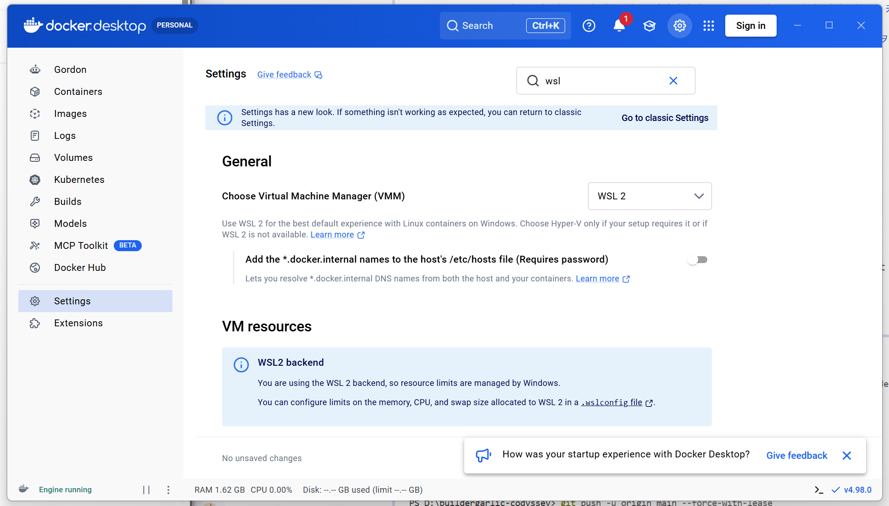
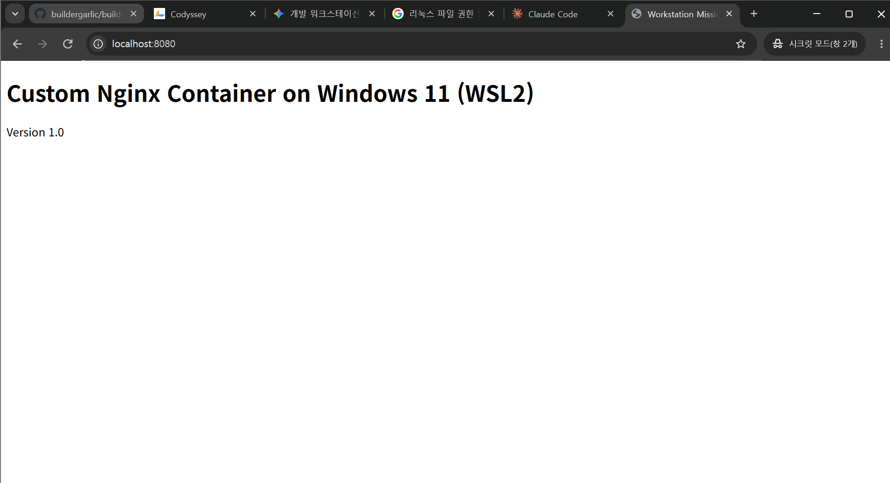
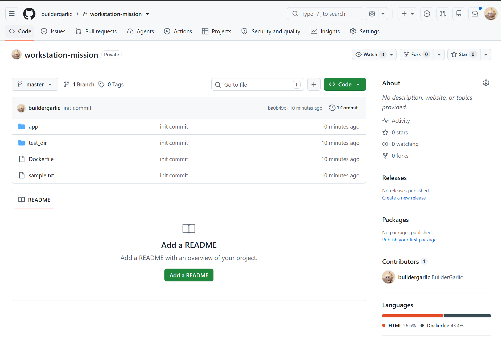
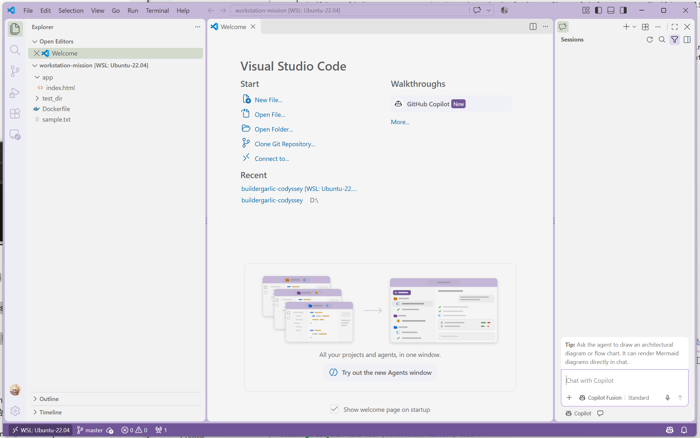

# Windows 11 · WSL2 · Docker Workstation Mission

Windows 11에서 WSL2와 Docker Desktop을 구성하고, Linux 파일 조작·권한 변경부터 Docker 이미지 빌드, 포트 매핑, 마운트, 볼륨 영속성, Git 연동까지 검증한 기록입니다.

> 검증 일자: 2026-11-04 (KST)
> 아래 “실제 실행 로그”에는 터미널에서 확인한 출력만 기록했습니다. 설치·장애 대응 명령은 “재현 절차”로 구분했습니다.

## 1. 평가 항목별 증거

| 평가 | 증거 위치 |
|---:|---|
| 1 | 4절: <code>mkdir</code>, <code>touch</code>, <code>cp</code>, <code>mv</code>, <code>rm</code> 실행 전후 목록과 시각 |
| 2 | 5절: <code>chmod 755/700</code> 전후 <code>ls -ld</code> 출력 |
| 3 | 6절: Docker Client/Server 버전, <code>docker info</code> Server 값, Engine running 화면 |
| 4 | 6절: <code>docker run hello-world</code>의 <code>Hello from Docker!</code> 출력 |
| 5 | 6절: 필터 없는 <code>docker images</code>, <code>docker ps -a</code> 출력 |
| 6 | 7절: 저장소의 실제 [Dockerfile](./Dockerfile), 웹 소스, 성공 빌드 로그 |
| 7 | 7절: <code>localhost:8080</code>의 HTTP 200 응답과 브라우저 화면 |
| 8 | 8절: 볼륨 기록 → 컨테이너 삭제 → 새 컨테이너에서 파일 복구 로그 |
| 9 | 10절: Git 사용자 설정, 원격 주소, 로컬/원격 추적 상태 |
| 10 | 3절: 디렉터리 설계 기준과 각 파일·폴더 역할 |
| 11 | 7·8절: 호스트:컨테이너 포트/경로 매핑 명세와 명령 순서 |
| 12 | 6절: 이미지(저장 템플릿)와 컨테이너(실행 인스턴스)의 차이 |
| 13 | 6절: 네트워크 네임스페이스와 포트 포워딩의 필요성 |
| 14 | 4절: 절대경로·상대경로 사용 기준과 예시 |
| 15 | 5절: rwx와 숫자 0~7 전체 매핑 |
| 16 | 9절: <code>ss</code>/<code>lsof</code>/Docker 조회 및 안전한 포트 해제 |
| 17 | 8절: 바인드 마운트와 Docker 볼륨 장단점·사용 사례 비교 |
| 18 | 10절: 실제 Git 오류, 조치 순서, 조치 후 원격 추적 상태 |

## 2. 실행 환경

| 구분 | 확인값 |
|---|---|
| Host OS | Windows 11 |
| Linux | WSL2 · Ubuntu 22.04.5 LTS |
| WSL2 Kernel | Linux 6.18.54.1-microsoft-standard-WSL2 |
| Shell | GNU bash 5.1.16 |
| Docker Desktop | 4.98.0, WSL2 backend |
| Docker Engine | 29.9.2, linux/amd64 |
| Git | 2.34.1 (WSL2 Ubuntu) |

최초 설치 재현 순서:

~~~powershell
# 관리자 PowerShell
wsl --install -d Ubuntu-22.04
wsl -l -v
winget install Docker.DockerDesktop
~~~

Docker Desktop에서 Settings → General → Use the WSL 2 based engine과 Settings → Resources → WSL Integration → Ubuntu-22.04를 활성화한 뒤 Apply & restart를 실행합니다.

## 3. 디렉터리 구조와 설계 기준

~~~text
buildergarlic-codyssey/
├── .dockerignore
├── Dockerfile
├── README.md
├── app/
│   └── index.html
└── screenshots/
    ├── container-webserver.png
    ├── docker.desktop-WSL2-Setting.png
    ├── vscode-github.png
    └── Websever-NginX-Container.png
~~~

| 경로 | 역할 |
|---|---|
| [Dockerfile](./Dockerfile) | Nginx 기반 커스텀 이미지 빌드 명세 |
| [.dockerignore](./.dockerignore) | Git 문서·스크린샷 등 불필요한 빌드 컨텍스트 제외 |
| [app/](./app) | 컨테이너가 서비스할 애플리케이션 소스 |
| [app/index.html](./app/index.html) | Nginx 정적 시작 페이지 |
| [screenshots/](./screenshots) | 브라우저, Docker Desktop, VS Code 검증 화면 |
| [README.md](./README.md) | 재현 절차, 실제 출력, 개념과 트러블슈팅 기록 |

실행 자산([Dockerfile](./Dockerfile), [app/](./app))과 문서·증거([README.md](./README.md), [screenshots/](./screenshots))를 분리했습니다. 저장소 루트를 빌드 컨텍스트로 사용하므로 <code>docker build .</code>의 <code>COPY ./app ...</code>가 같은 구조로 동작합니다. 권한 실습용 <code>test_dir/</code>는 임시 디렉터리라 제출 구조에서 제외했습니다.

## 4. 경로 기준과 파일·폴더 조작

### 절대경로와 상대경로

- 절대경로는 현재 디렉터리와 관계없이 같은 대상을 가리킵니다. 작업 위치 검증이나 바인드 마운트 원본처럼 경로 오류가 치명적인 곳에 사용합니다. 예: <code>/home/buildergarlic/workstation-mission/app</code>
- 상대경로는 현재 <code>pwd</code>를 기준으로 해석됩니다. 프로젝트 루트로 이동한 뒤 내부 파일을 다룰 때 사용합니다. 예: <code>./app</code>, <code>app/index.html</code>, <code>docker build .</code>
- “WSL2 홈을 사용한다”는 프로젝트 저장 위치 기준입니다. 모든 명령 인자까지 절대경로로 써야 한다는 뜻은 아닙니다.

Linux 권한과 빠른 바인드 마운트 I/O 검증을 위해 원본 실습은 Windows 마운트 영역인 <code>/mnt/c</code>가 아니라 WSL2 네이티브 경로인 <code>/home/buildergarlic/workstation-mission</code>에서 수행했습니다.

### 파일 생성·복사·이동·삭제 실제 로그

~~~console
[2026-11-04 20:59~21:03 KST, WSL2 Bash]

$ mkdir -p ~/workstation-mission
$ cd ~/workstation-mission
$ mkdir test_dir
$ touch empty_file.txt
$ echo "Hello Windows 11 WSL2 Workstation" > sample.txt
$ ls -la
total 16
drwxr-xr-x 3 buildergarlic buildergarlic 4096 Nov  4 21:00 .
drwxr-x--- 6 buildergarlic buildergarlic 4096 Nov  4 20:54 ..
-rw-r--r-- 1 buildergarlic buildergarlic    0 Nov  4 20:59 empty_file.txt
-rw-r--r-- 1 buildergarlic buildergarlic   34 Nov  4 21:00 sample.txt
drwxr-xr-x 2 buildergarlic buildergarlic 4096 Nov  4 20:59 test_dir

$ cp sample.txt sample_copy.txt
$ mv sample_copy.txt test_dir/moved_sample.txt
$ ls -l test_dir/
total 4
-rw-r--r-- 1 buildergarlic buildergarlic 34 Nov  4 21:03 moved_sample.txt

$ rm empty_file.txt
$ ls -la
total 16
drwxr-xr-x 3 buildergarlic buildergarlic 4096 Nov  4 21:03 .
drwxr-x--- 6 buildergarlic buildergarlic 4096 Nov  4 20:54 ..
-rw-r--r-- 1 buildergarlic buildergarlic   34 Nov  4 21:00 sample.txt
drwxr-xr-x 2 buildergarlic buildergarlic 4096 Nov  4 21:03 test_dir
~~~

마지막 목록에서 <code>empty_file.txt</code>는 사라졌고, 이동된 파일은 <code>test_dir/moved_sample.txt</code>에 존재하므로 생성·이동·삭제가 모두 검증됩니다.

## 5. Linux 권한 변경

각 8진수 자리는 차례로 소유자(User), 그룹(Group), 기타 사용자(Others)의 권한입니다. 한 자리 값은 <code>r=4</code>, <code>w=2</code>, <code>x=1</code>의 합입니다.

| 숫자 | 기호 | 허용 권한 |
|---:|:---:|---|
| 0 | <code>---</code> | 없음 |
| 1 | <code>--x</code> | 실행 |
| 2 | <code>-w-</code> | 쓰기 |
| 3 | <code>-wx</code> | 쓰기 + 실행 |
| 4 | <code>r--</code> | 읽기 |
| 5 | <code>r-x</code> | 읽기 + 실행 |
| 6 | <code>rw-</code> | 읽기 + 쓰기 |
| 7 | <code>rwx</code> | 읽기 + 쓰기 + 실행 |

예를 들어 755는 소유자 <code>rwx</code>, 그룹 <code>r-x</code>, 기타 사용자 <code>r-x</code>이고, 700은 소유자만 모든 권한을 가집니다. 디렉터리의 <code>x</code>는 그 안으로 진입·탐색할 권한입니다.

### 변경 전·후 실제 로그

~~~console
[2026-11-04 21:03 KST, /home/buildergarlic/workstation-mission]

$ ls -ld test_dir sample.txt
-rw-r--r-- 1 buildergarlic buildergarlic   34 Nov  4 21:00 sample.txt
drwxr-xr-x 2 buildergarlic buildergarlic 4096 Nov  4 21:03 test_dir

$ chmod 755 sample.txt
$ chmod 700 test_dir
$ ls -ld test_dir sample.txt
-rwxr-xr-x 1 buildergarlic buildergarlic   34 Nov  4 21:00 sample.txt
drwx------ 2 buildergarlic buildergarlic 4096 Nov  4 21:03 test_dir
~~~

파일은 644 → 755, 디렉터리는 755 → 700으로 바뀌었습니다. <code>/mnt/c</code>의 NTFS/DrvFs는 설정에 따라 POSIX 권한 변경을 그대로 보존하지 않을 수 있으므로 이 검증은 WSL2의 Linux 파일 시스템에서 수행했습니다.

## 6. Docker 데몬, 이미지와 컨테이너

### 이미지와 컨테이너의 역할

Docker 이미지는 [Dockerfile](./Dockerfile)과 소스를 빌드한 읽기 전용 실행 템플릿, 즉 저장 결과입니다. 컨테이너는 그 이미지로 만든 실행 인스턴스입니다.

- <code>docker build -t custom-nginx:1.0 .</code>: 재사용할 이미지를 저장합니다.
- <code>docker run custom-nginx:1.0</code>: 이미지로 새 컨테이너를 생성하고 실행합니다.
- 컨테이너의 쓰기 계층을 수정해도 원본 이미지는 바뀌지 않습니다. 변경을 이미지에 포함하려면 다시 빌드해야 합니다.
- 컨테이너를 삭제하면 쓰기 계층도 사라집니다. 보존할 데이터는 바인드 마운트나 Docker 볼륨에 둡니다.

### 네트워크 네임스페이스와 포트 포워딩

컨테이너는 호스트와 분리된 네트워크 네임스페이스(IP, 인터페이스, 포트 공간)를 가집니다. 따라서 컨테이너 내부 Nginx가 TCP 80에서 대기해도 호스트에서 그 포트에 바로 접속할 수 없습니다.

<code>-p 8080:80</code>은 호스트 TCP 8080 요청을 컨테이너 TCP 80으로 전달하므로 호스트에서는 <code>http://localhost:8080</code>으로 접속합니다. [Dockerfile](./Dockerfile)의 <code>EXPOSE 80</code>은 사용할 포트를 문서화할 뿐 실제로 호스트에 공개하지 않으며, 공개에는 <code>-p</code>가 필요합니다.

### Docker Client와 Server(데몬) 실제 확인

Docker Desktop이 엔진을 관리하므로 WSL2 내부의 <code>systemctl status docker</code> 대신 <code>docker version</code>의 Server 구간과 <code>docker info</code>의 Server 값을 확인했습니다.

~~~console
[2026-11-04 22:40 KST, PowerShell]

PS> docker version
Client:
 Version:           29.9.2
 API version:       1.56
 OS/Arch:           windows/amd64
 Context:           desktop-linux

Server: Docker Desktop 4.98.0 (245422)
 Engine:
  Version:          29.9.2
  API version:      1.56 (minimum version 1.40)
  OS/Arch:          linux/amd64
  Experimental:     false

PS> docker info --format "ServerVersion={{.ServerVersion}}; OSType={{.OSType}}; OperatingSystem={{.OperatingSystem}}; Containers={{.Containers}}; Images={{.Images}}"
ServerVersion=29.9.2; OSType=linux; OperatingSystem=Docker Desktop; Containers=2; Images=4
~~~

Server 값이 반환되었다는 것은 CLI가 실제 데몬 소켓에 연결되어 질의를 완료했다는 뜻입니다.

### hello-world 실제 출력

~~~console
[2026-11-04 KST, WSL2 Bash]

$ docker run hello-world
Unable to find image 'hello-world:latest' locally
latest: Pulling from library/hello-world
4f55086f7dd0: Pull complete
d5e71e642bf5: Download complete
Digest: sha256:c567b231f65614688711a75f31518a064258a51d442117a3e771a3a8fdba78ef
Status: Downloaded newer image for hello-world:latest

Hello from Docker!
This message shows that your installation appears to be working correctly.

To generate this message, Docker took the following steps:
 1. The Docker client contacted the Docker daemon.
 2. The Docker daemon pulled the "hello-world" image from the Docker Hub.
 3. The Docker daemon created a new container from that image.
 4. The Docker daemon streamed that output to the Docker client.
~~~

### 이미지와 전체 컨테이너 목록

~~~console
[2026-11-04 22:41:11+09:00, PowerShell]

PS> docker images --format "table {{.Repository}}\t{{.Tag}}\t{{.ID}}\t{{.Size}}"
REPOSITORY     TAG       IMAGE ID       SIZE
custom-nginx   1.0       cce00524d0bf   93.6MB
ubuntu         22.04     076e7bf82319   119MB
alpine         latest    be2656061b53   13MB
hello-world    latest    c567b231f656   25.9kB

PS> docker ps -a --format "table {{.ID}}\t{{.Image}}\t{{.Status}}\t{{.Ports}}\t{{.Names}}"
CONTAINER ID   IMAGE              STATUS                             PORTS                                     NAMES
a3ed518fc940   custom-nginx:1.0   Up 27 seconds (health: starting)   0.0.0.0:8080->80/tcp, [::]:8080->80/tcp   web-server
415d6191fc85   ubuntu:22.04       Exited (137) About an hour ago                                               my-ubuntu
0692d7cb1287   hello-world        Exited (0) About an hour ago                                                 romantic_rhodes
~~~

## 7. 커스텀 이미지 빌드와 포트 매핑

### 실제 제출 파일

[Dockerfile](./Dockerfile)의 내용:

~~~dockerfile
FROM nginx:alpine

LABEL maintainer="buildergarlic"

COPY ./app /usr/share/nginx/html

EXPOSE 80

HEALTHCHECK --interval=30s --timeout=3s \
  CMD wget -qO- http://localhost/ || exit 1
~~~

서비스할 HTML은 [app/index.html](./app/index.html)에 실제 파일로 제출했습니다.

### 실제 빌드 로그

~~~console
[2026-11-04T22:40:33+09:00, 저장소 루트]

PS> docker build -t custom-nginx:1.0 .
#0 building with "desktop-linux" instance using docker driver

#1 [internal] load build definition from Dockerfile
#1 transferring dockerfile: 223B done
#1 DONE 0.0s

#2 [internal] load metadata for docker.io/library/nginx:alpine
#2 DONE 1.4s

#3 [internal] load .dockerignore
#3 transferring context: 78B done
#3 DONE 0.0s

#4 [internal] load build context
#4 transferring context: 350B done
#4 DONE 0.0s

#5 [1/2] FROM docker.io/library/nginx:alpine@sha256:785835ea65db4bba6f021acc0f3be91b0fef76a53fe41f8588c6698d2aed0606
#5 CACHED

#6 [2/2] COPY ./app /usr/share/nginx/html
#6 DONE 0.0s

#7 exporting to image
#7 exporting layers 0.1s done
#7 naming to docker.io/library/custom-nginx:1.0 done
#7 unpacking to docker.io/library/custom-nginx:1.0 done
#7 DONE 0.2s
~~~

### 매핑 명세와 재현 순서

Docker의 매핑 표기는 <code>호스트:컨테이너</code> 순서입니다.

| 목적 | 실행 옵션 | 호스트 측 | 컨테이너 측 |
|---|---|---|---|
| 기본 웹 서버 | <code>-p 8080:80</code> | TCP 8080 | Nginx TCP 80 |
| 바인드 마운트 웹 서버 | <code>-p 8081:80</code> | TCP 8081 | Nginx TCP 80 |
| 웹 소스 공유 | <code>$(pwd)/app:/usr/share/nginx/html</code> | 프로젝트 app 디렉터리 | Nginx 문서 루트 |
| 영속 데이터 | <code>mission-vol:/data</code> | Docker 관리 볼륨 | 컨테이너 /data |

~~~bash
cd ~/workstation-mission
docker build -t custom-nginx:1.0 .
docker run -d --name web-server -p 8080:80 custom-nginx:1.0
curl -i http://localhost:8080
docker inspect --format '{{.State.Health.Status}}' web-server
docker stop web-server
docker rm web-server
~~~

### 호스트 포트 접속 실제 로그

~~~console
[2026-11-04T22:40:44+09:00, PowerShell]

PS> docker run -d --name web-server -p 8080:80 custom-nginx:1.0
a3ed518fc940821d98a11e5192958af2fc0f1593291dae75db20898775d97a27

PS> curl.exe -i http://localhost:8080
HTTP/1.1 200 OK
Server: nginx/1.31.8
Date: Wed, 04 Nov 2026 13:40:46 GMT
Content-Type: text/html
Content-Length: 280
Connection: keep-alive

<!doctype html>
<html lang="ko">
<head>
  <meta charset="utf-8">
  <title>Workstation Mission</title>
</head>
<body>
  <h1>Custom Nginx Container on Windows 11 (WSL2)</h1>
  
Version 1.0

</body>
</html>

PS> docker inspect --format "Health={{if .State.Health}}{{.State.Health.Status}}{{else}}none{{end}}" web-server
Health=healthy
~~~

HTTP 200과 HTML 본문, 컨테이너 healthy 상태를 모두 확인했습니다.

## 8. 바인드 마운트와 볼륨 영속성

### 두 방식의 차이

| 방식 | 장점 | 주의점과 적합 사례 |
|---|---|---|
| 바인드 마운트 | 지정한 호스트 파일을 컨테이너와 직접 공유해 수정 결과가 즉시 반영됩니다. | 호스트 경로·권한에 의존합니다. 개발 중인 소스·설정 공유에 적합합니다. |
| Docker 볼륨 | Docker가 저장 위치를 관리하며 컨테이너를 삭제해도 <code>docker volume rm</code> 전까지 데이터가 남습니다. | 호스트에서 직접 편집하기는 덜 편하지만 DB·애플리케이션 상태 보존에 적합합니다. |

### 바인드 마운트 즉시 반영 실제 로그

~~~console
[2026-11-04 KST, WSL2 Bash]

$ docker run -d --name bind-web -p 8081:80 \
    -v "$(pwd)/app:/usr/share/nginx/html" custom-nginx:1.0
ebd5ee3377b74a813864dd32ea29f8c11a4681c45e84cc7a1bafaa031bb333f3

$ curl http://localhost:8081
<!DOCTYPE html>
<html>
<body>
  <h1>Custom Nginx Container on Windows 11 (WSL2)</h1>
  
Version 1.0

</body>
</html>

$ sed -i 's/Version 1.0/Version 2.0 (Bind Mounted on WSL2)/g' app/index.html
$ curl http://localhost:8081
<!DOCTYPE html>
<html>
<body>
  <h1>Custom Nginx Container on Windows 11 (WSL2)</h1>
  
Version 2.0 (Bind Mounted on WSL2)

</body>
</html>

$ docker stop bind-web
bind-web
$ docker rm bind-web
bind-web
~~~

이미지를 다시 빌드하지 않았는데도 호스트 파일의 1.0 → 2.0 변경이 컨테이너 응답에 즉시 반영되었습니다.

### 볼륨의 컨테이너 삭제 전·후 실제 로그

~~~console
[2026-11-04 KST, WSL2 Bash]

$ docker volume create mission-vol
mission-vol

$ docker volume ls | grep mission-vol
local     mission-vol

$ docker run --name vol-writer -v mission-vol:/data alpine \
    sh -c "echo 'Persistent Data Test 123' > /data/record.txt && cat /data/record.txt"
Persistent Data Test 123

$ docker rm vol-writer
vol-writer

$ docker run --rm --name vol-reader -v mission-vol:/data \
    alpine cat /data/record.txt
Persistent Data Test 123
~~~

<code>vol-writer</code>를 삭제한 뒤 새 <code>vol-reader</code>에서 같은 파일을 읽었으므로 데이터가 컨테이너 계층이 아니라 볼륨에 보존되었음을 확인했습니다.

2026-11-04 22:41 KST에 같은 볼륨을 다시 연결해 파일 자체도 재확인했습니다.

~~~console
PS> docker volume ls --filter "name=mission-vol"
DRIVER    VOLUME NAME
local     mission-vol

PS> docker run --rm --name vol-proof -v mission-vol:/data \
      alpine sh -c "ls -l /data/record.txt && cat /data/record.txt"
-rw-r--r--    1 root     root            25 Nov  4 12:54 /data/record.txt
Persistent Data Test 123
~~~

## 9. 포트 충돌 진단과 해제

<code>Bind for 0.0.0.0:8080 failed: port is already allocated</code>가 발생하면 다음 순서로 처리합니다.

1. WSL2에서 리스닝 소켓과 PID를 확인합니다.

~~~bash
ss -ltnp | grep ':8080 '
sudo lsof -nP -iTCP:8080 -sTCP:LISTEN
~~~

2. Docker 컨테이너가 포트를 게시했는지 먼저 확인합니다.

~~~bash
docker ps --filter "publish=8080" \
  --format "table {{.ID}}\t{{.Names}}\t{{.Ports}}"
~~~

3. Docker 컨테이너가 점유했다면 확인한 컨테이너만 정상 종료합니다.

~~~bash
docker stop <확인한_컨테이너_이름>
docker rm <확인한_컨테이너_이름>
~~~

4. 일반 프로세스라면 1단계의 PID와 명령행을 다시 확인한 후 정상 종료 신호를 보냅니다. 무관한 PID를 종료하지 않습니다.

~~~bash
ps -fp <확인한_PID>
kill -TERM <확인한_PID>
ss -ltnp | grep ':8080 ' || echo "8080 port is free"
~~~

5. 해당 서비스를 중지할 수 없으면 충돌하지 않는 호스트 포트를 선택합니다. 컨테이너 내부 포트 80은 그대로 둘 수 있습니다.

~~~bash
docker run -d --name web-server-alt -p 8082:80 custom-nginx:1.0
curl -i http://localhost:8082
~~~

Windows 프로세스가 점유한 경우 PowerShell에서 <code>Get-NetTCPConnection -LocalPort 8080 -State Listen</code>과 <code>Get-Process -Id &lt;PID&gt;</code>로 소유자를 확인한 뒤 해당 애플리케이션을 정상 종료합니다.

## 10. Git 설정·원격 상태·트러블슈팅

### 사용자 설정 실제 로그

~~~console
$ git config --global user.name "buildergarlic"
$ git config --global user.email "nobody@nobody.com"
$ git config --global init.defaultBranch main
$ git config --list
user.name=buildergarlic
user.email=nobody@nobody.com
init.defaultbranch=main
core.repositoryformatversion=0
core.filemode=true
core.bare=false
core.logallrefupdates=true
~~~

### 원격 주소와 추적 상태 실제 로그

~~~console
[2026-11-04 22:41 KST, PowerShell]

PS> git remote -v
origin  https://github.com/buildergarlic/buildergarlic-codyssey.git (fetch)
origin  https://github.com/buildergarlic/buildergarlic-codyssey.git (push)

PS> git branch -vv
* main 8d572c6 [origin/main] 실행 완료 커밋

PS> git log -1 --date=iso --pretty=format:"%h %ad %s"
8d572c6 2026-11-04 22:28:40 +0900 실행 완료 커밋
~~~

캡처 시점에 로컬 <code>main</code>이 <code>origin/main</code>을 추적하고 동일 커밋을 가리켰습니다.

### Case 1: 잘못된 git config 키

실제 오류:

~~~console
PS> git config --global buildergarlic
error: key does not contain a section: buildergarlic

PS> git config --global nobody@nobody.com
error: invalid key: nobody@nobody.com
~~~

Git 설정 키는 <code>section.key</code> 형식이어야 하는데 값만 키 위치에 넣은 것이 원인입니다.

~~~powershell
git config --global user.name "buildergarlic"
git config --global user.email "nobody@nobody.com"
git config --global --get user.name
git config --global --get user.email
~~~

### Case 2: 원격 push 거부

실제 오류:

~~~console
PS> git push -u origin main
remote: fatal error in commit_refs
To https://github.com/buildergarlic/buildergarlic-codyssey.git
 ! [remote rejected] main -> main (failure)
error: failed to push some refs to 'https://github.com/buildergarlic/buildergarlic-codyssey.git'
~~~

조치 순서:

~~~powershell
# 1. 대상 원격 주소 확인·교정
git remote -v
git remote set-url origin https://github.com/buildergarlic/buildergarlic-codyssey.git

# 2. 로컬 객체 검증 및 일반 정리
git fsck --full
git gc

# 3. 원격 상태를 받은 뒤 차이 확인
git fetch origin
git log --oneline --graph --decorate --all -n 15

# 4. 일반 push 우선 시도
git push -u origin main

# 원격 이력을 의도적으로 대체해야 하고 차이를 검토한 경우에만
git push -u origin main --force-with-lease
~~~

<code>--force-with-lease</code>는 확인하지 않은 새 원격 커밋이 있으면 덮어쓰기를 거부하므로 <code>--force</code>보다 안전하지만, 원격 이력을 바꿀 수 있어 마지막 수단으로만 사용합니다. 조치 후의 원격 주소와 추적 상태는 위 실제 로그에 기록했습니다.

### Case 3: WSL2에서 Docker 데몬 연결 실패

~~~text
Cannot connect to the Docker daemon at unix:///var/run/docker.sock.
Is the docker daemon running?
~~~

Docker Desktop의 Settings → Resources → WSL Integration에서 Ubuntu-22.04를 활성화하고 Apply & restart한 뒤 <code>docker version</code>과 <code>docker info</code>를 다시 실행합니다. 6절의 Server 출력과 Engine running 화면이 해결 후 증거입니다.

### Case 4: /mnt/c에서 chmod가 반영되지 않음

Windows NTFS를 WSL에 연결한 <code>/mnt/c</code>에서는 마운트 설정에 따라 Linux POSIX 권한 메타데이터가 보존되지 않을 수 있습니다. <code>df -T .</code>와 <code>mount | grep '/mnt/c'</code>로 파일 시스템을 확인하고, 권한 실습은 <code>/home/&lt;사용자&gt;</code> 아래로 옮겨 재수행합니다. 5절의 644 → 755, 755 → 700 출력이 해결 후 증거입니다.

## 11. 화면 증거

화면 캡처는 보조 증거이며, 재현 가능한 명령과 텍스트 출력은 본문에 함께 기록했습니다.

---

## 부록: 기존 상세 실습 로그

아래에는 최초 작성 당시의 전체 명령 흐름을 당시 형태 그대로 보존했습니다. 부록은 이력 증거이며 현재 권장 절차는 위 1~10절입니다.

> 안전 주의: 부록의 <code>git gc --prune=now</code>는 도달할 수 없는 객체를 즉시 정리해 복구 가능성을 낮출 수 있으므로 백업과 영향 검토 없이 재실행하지 않습니다. 또한 부록 마지막의 “단순 오타” 문장은 Git 사용자 설정 오류의 원인을 뜻할 뿐, 원격 <code>commit_refs</code> 오류의 원인까지 입증한 것은 아닙니다.

기존 원본 상세 실습 로그 보기

## 1. 실행환경
| **OS** | Windows 11 (WSL2 - Ubuntu 22.04.x LTS, Kernel 5.15.x / 6.6.x) |
| **Shell / Terminal** | GNU bash 5.1.16 (Windows Terminal + VSCode Remote-WSL Terminal) |
| **Container Engine** | Docker Desktop for Windows (WSL2 Backend Engine) v27.x.x |
| **Git Version** | git version 2.34.1 (WSL2 Ubuntu 내장 Git) |

## 2. 수행 체크리스트
- [x] 터미널 기본 조작 및 폴더 구성
- [x] 권한 변경 실습
- [x] Docker 설치/점검
- [x] hello-world 실행
- [x] Dockerfile 빌드/실행
- [x] 포트 매핑 접속(2회)
- [x] 바인드 마운트 반영
- [x] 볼륨 영속성
- [x] Git 설정 + VSCode GitHub 연동
- [x] 추가 선택 Docker Compose 설정 

## 3. 설치 진행과 수행 로그(핵심 발췌)
1. Windows 11 사전 환경 세팅 (PowerShell 관리자 권한)
WSL2와 Docker Desktop이 아직 설치되지 않았거나 연동 설정이 안 된 경우 아래 절차를 먼저 수행합니다.

1-1. WSL2 활성화
wsl --install --no-distribution
백엔드 엔진만 활성화

1-1-1. 왜 WSL 설치?
- Windows 11에서 Windows용 Docker Desktop을 설치할 때 WSL2(Windows Subsystem for Linux 2)는 사실상 필수입니다. 단, 사용자가 직접 Ubuntu 배포판을 따로 설치할 필요는 없습니다.
- 도커의 태생적 구조: 도커 컨테이너(Linux 컨테이너)는 Linux 커널의 핵심 기능(Cgroups, Namespaces)을 공유하여 작동합니다. Windows 커널에는 이 기능이 직접 들어있지 않으므로, 백그라운드에서 경량 Linux 커널을 띄워줄 가상화 계층(WSL2)이 반드시 필요합니다.

- Windows의 기본 파일 시스템(NTFS)이나 Git Bash(MinGW)에서는 리눅스의 8진수 권한(chmod 700 등)이 정상적으로 반영되지 않아 과제 검증(요구사항 4-3)에서 결함이 발생합니다. 또한 WSL2의 /mnt/c/... 경로(Windows 호스트 마운트 경로)에서 작업할 경우에도 권한 변경이 무시되거나 Docker 바인드 마운트 I/O 성능 저하가 발생하므로, 반드시 WSL2 내부의 리눅스 네이티브 홈 디렉토리(~ 또는 /home/<계정명>)에서 모든 실습을 진행해야 합니다.
*(참고: 미션 안내문의 OrbStack은 macOS 전용 도구이므로, Windows 11에서는 Docker Desktop (WSL2 백엔드 모드)*으로 대체하여 구동합니다.)

1-1-2. WSL vs WSL2
- WSL 1은 윈도우가 리눅스 흉내를 내는 번역기라면, WSL 2는 윈도우 안에 진짜 리눅스 커널을 통째로 집어넣은 가상 머신입니다.
- Docker를 구축할 때 WSL 2는 별도 설정 없이 완벽하게 기본 지원하지만, WSL 1은 아키텍처 한계로 Docker를 정상적으로 구동할 수 없습니다.

1-1-3. WSL2 (경량 Hyper-V 기반)
1) 윈도우즈 Hyper-V 설치 필요
2) 윈도우즈 "선택적 기능"(설정->앱->선택 기능)에서 추가
3) 명령어줄에서 다음 명령어 실행
3-1) 키보드에서 Win + R 키를 눌러 실행창을 엽니다.
3-2) 열기 칸에 ms-settings:optionalfeatures를 입력하고 확인을 누릅니다.
3-3) 선택적 기능 설정 화면이 즉시 나타납니다
**코디세이 코딩스튜디오에서는 실행 안됨.(설정 진입 막혀 있음)
**설치된 것을 가정하고 진행한다.

1-2. Docker Desktop for Windows 설치
2-2-1. Docker 왜 설치?
"내 컴퓨터에서는 잘 돌아가는데, 서버나 다른 사람 컴퓨터에서는 왜 안 되지?"(일명 "It works on my machine") 문제를 원천 차단하기 위함입니다.

1) WSL2 및 Ubuntu 22.04 설치
Windows 터미널(PowerShell)을 관리자 권한으로 열고 실행합니다.
# WSL2 활성화 및 Ubuntu 22.04 설치
wsl --install -d Ubuntu-22.04

# 설치 및 재부팅 후 WSL 버전이 2인지 확인 (VERSION이 2여야 함)
wsl -l -v

2) Docker Desktop 설치 및 WSL2 통합 설정
2-1) PowerShell에서 Winget으로 설치하거나 공식 홈페이지에서 설치합니다.
[PowerShell]
winget install Docker.DockerDesktop

2-2) Docker Desktop 실행 후 필수 설정 확인:
- Settings (톱니바퀴) -> General -> Use the WSL 2 based engine 체크 확인
- Settings -> Resources -> WSL Integration -> Enable integration with my default WSL distro 체크 및 Ubuntu-22.04 토글 활성화 -> Apply & restart 클릭

3) VSCode 확장 프로그램 설치 (Windows 호스트)
VSCode를 열고 아래 확장(Extension)을 설치해야 WSL 내부 폴더를 직접 열고 GitHub 연동을 캡처할 수 있습니다.
- WSL (ms-vscode-remote.remote-wsl)
- Docker (ms-azuretools.vscode-docker)

2. WSL2(Ubuntu) 터미널 진입 및 실습 수행
이제 PowerShell이 아닌 Ubuntu 터미널(Windows 터미널에서 Ubuntu 탭 선택 또는 wsl -d Ubuntu-22.04 입력)을 엽니다.

Step 0: 작업 위치 검증 (가장 중요)
# 반드시 /mnt/c/... 가 아닌 /home/<유저명> 경로로 이동해야 chmod 권한 실습이 정상 작동함
cd ~
pwd
# 출력 예시: /home/don
*왜요? 리눅스 명령어인 chmod로 권한이 진짜 바뀌는 걸 눈으로 확인하고 실습하려면, 윈도우 영토(/mnt/c)가 아닌 리눅스 본연의 영토(/home/<유저명>)에서 작업해야 하기 때문이다.

1. 파일 시스템의 근본적인 차이
• /home/<유저명>: 리눅스 고유의 파일 시스템(ext4 등)을 사용하므로, 리눅스의 파일 권한 체계(rwxr-xr-x 등)가 완벽하게 기록되고 작동합니다.
• /mnt/c/...: 윈도우의 NTFS 파일 시스템입니다. 윈도우는 리눅스와 권한을 관리하는 방식(ACL 구조)이 완전히 달라서 리눅스의 chmod 명령이 먹히지 않거나 무시됩니다.

2. /mnt/c/...에서 실행하면 생기는 문제
기본 설정 상태의 WSL에서 /mnt/c/에 있는 파일에 chmod 755나 chmod 644를 실행하면, 명령어는 에러 없이 실행되는 것처럼 보이지만 실제 권한은 전혀 바뀌지 않고 고정되어 있습니다.
• 모든 파일이 무조건 777(또는 rwxrwxrwx)로 보이거나, 변경 요청이 무시되어 실습 결과가 정상적으로 확인되지 않습니다.

## Step 1: 작업 디렉토리 생성 및 터미널 기본 조작 (요구사항 4-2)
# 1. 작업 폴더 생성 및 이동
[Bash]
mkdir -p ~/workstation-mission && cd ~/workstation-mission
buildergarlic@GNIA-C202-A01:~$ mkdir -p ~/workstation-mission && cd ~/workstation-mission

# 2. 현재 위치 확인
[Bash]
pwd
buildergarlic@GNIA-C202-A01:~/workstation-mission$ pwd
/home/buildergarlic/workstation-mission

# 3. 빈 파일 및 디렉토리 생성
[Bash]
mkdir test_dir
touch empty_file.txt
echo "Hello Windows 11 WSL2 Workstation" > sample.txt

# 4. 목록 확인 (숨김 파일 포함) 및 파일 내용 확인
[Bash]
ls -la
buildergarlic@GNIA-C202-A01:~/workstation-mission$ ls -al
total 16
drwxr-xr-x 3 buildergarlic buildergarlic 4096 Nov  4 21:00 .
drwxr-x--- 6 buildergarlic buildergarlic 4096 Nov  4 20:54 ..
-rw-r--r-- 1 buildergarlic buildergarlic    0 Nov  4 20:59 empty_file.txt
-rw-r--r-- 1 buildergarlic buildergarlic   34 Nov  4 21:00 sample.txt
drwxr-xr-x 2 buildergarlic buildergarlic 4096 Nov  4 20:59 test_dir

[Bash]
cat sample.txt
buildergarlic@GNIA-C202-A01:~/workstation-mission$ cat sample.txt
Hello Windows 11 WSL2 Workstation

# 5. 복사, 이동/이름변경, 삭제
[Bash]
cp sample.txt sample_copy.txt
mv sample_copy.txt test_dir/moved_sample.txt
ls -l test_dir/
buildergarlic@GNIA-C202-A01:~/workstation-mission$ cp sample.txt sample_copy.txt
buildergarlic@GNIA-C202-A01:~/workstation-mission$ mv sample_copy.txt test_dir/moved_sample.txt
buildergarlic@GNIA-C202-A01:~/workstation-mission$ ls -l test_dir/
total 4
-rw-r--r-- 1 buildergarlic buildergarlic 34 Nov  4 21:03 moved_sample.txt

[Bash]
rm empty_file.txt
ls -la
drwxr-xr-x 3 buildergarlic buildergarlic 4096 Nov  4 21:03 .
drwxr-x--- 6 buildergarlic buildergarlic 4096 Nov  4 20:54 ..
-rw-r--r-- 1 buildergarlic buildergarlic   34 Nov  4 21:00 sample.txt
drwxr-xr-x 2 buildergarlic buildergarlic 4096 Nov  4 21:03 test_dir
buildergarlic@GNIA-C202-A01:~/workstation-mission$ 

## Step 2: 파일 및 디렉토리 권한 실습 (요구사항 4-3) - Permission 
WSL2 네이티브 경로(~/workstation-mission)이므로 chmod 결과가 즉시 반영됩니다.

# 변경 전 권한 확인 (일반적으로 파일 644, 디렉토리 755)
[Bash]
ls -ld test_dir sample.txt
buildergarlic@GNIA-C202-A01:~/workstation-mission$ ls -ld test_dir sample.txt
-rw-r--r-- 1 buildergarlic buildergarlic   34 Nov  4 21:00 sample.txt
drwxr-xr-x 2 buildergarlic buildergarlic 4096 Nov  4 21:03 test_dir

# 권한 변경 (파일: 644 -> 755, 디렉토리: 755 -> 700)
[Bash]
chmod 755 sample.txt
chmod 700 test_dir

# 변경 후 권한 확인 (-rwxr-xr-x 및 drwx------ 로 변경된 것 확인)
[Bash] 이하 명령어는 모두 Bash로 생략한다.
ls -ld test_dir sample.txt
buildergarlic@GNIA-C202-A01:~/workstation-mission$ ls -ld test_dir sample.txt
-rwxr-xr-x 1 buildergarlic buildergarlic   34 Nov  4 21:00 sample.txt
drwx------ 2 buildergarlic buildergarlic 4096 Nov  4 21:03 test_dir

**리눅스 파일 권한 숫자(644, 755, 700)는 [소유자(User) · 그룹(Group) · 기타 사용자(Others)] 각각의 권한을 숫자로 조합한 것입니다.

권한의 기본 값은 읽기(Read = 4), 쓰기(Write = 2), 실행(Execute = 1)의 합으로 계산합니다.
• 4: 읽기 (r) / • 2: 쓰기 (w) / • 1: 실행 (x) / • 0: 권한 없음 (-)

1. 644 (rw-r--r--)
• 소유자(6 = 4+2): 읽기(4) + 쓰기(2) 가능
• 그룹(4): 읽기(4)만 가능
• 기타 사용자(4): 읽기(4)만 가능
• 주요 용도: 일반 문서 파일, 설정 파일, 웹 페이지용 소스코드 파일 (수정은 소유자만 하고, 남들은 보기만 함)

2. 755 (rwxr-xr-x)
• 소유자(7 = 4+2+1): 읽기(4) + 쓰기(2) + 실행(1) 모두 가능
• 그룹(5 = 4+1): 읽기(4) + 실행(1) 가능 (수정은 불가)
• 기타 사용자(5 = 4+1): 읽기(4) + 실행(1) 가능 (수정은 불가)
• 주요 용도: 디렉터리(폴더) 기본값, 실행 가능한 프로그램이나 셸 스크립트(.sh)

3. 700 (rwx------)
• 소유자(7 = 4+2+1): 읽기(4) + 쓰기(2) + 실행(1) 모두 가능
• 그룹(0): 권한 없음 (---)
• 기타 사용자(0): 권한 없음 (---)
• 주요 용도: 오직 소유자 본인만 접근할 수 있어야 하는 민감한 디렉터리나 파일 (예: 사용자 SSH키가 담긴 .ssh 폴더, 비밀번호 파일 등)

## Step 3: Docker 설치 점검 및 기본 운영 명령 (요구사항 4-4, 4-5, 4-6)

# 버전 및 데몬 동작 점검 (Docker Desktop WSL Integration이 켜져 있어야 동작함)
docker --version
buildergarlic@GNIA-C202-A01:~/workstation-mission$ docker --version
Docker version 29.9.2, build a82e528

docker info | head -n 25
buildergarlic@GNIA-C202-A01:~/workstation-mission$ docker info | head -n 25
Client:
 Version:    29.9.2
 Context:    default
 Debug Mode: false
 Plugins:
  agent: Docker AI Agent Runner (Docker Inc.)
    Version:  v1.152.0
    Path:     /usr/local/lib/docker/cli-plugins/docker-agent
  ai: Docker AI Agent - Ask Gordon (Docker Inc.)
    Version:  v1.33.0
    Path:     /usr/local/lib/docker/cli-plugins/docker-ai
  buildx: Docker Buildx (Docker Inc.)
    Version:  v0.38.1
    Path:     /usr/local/lib/docker/cli-plugins/docker-buildx
  compose: Docker Compose (Docker Inc.)
    Version:  v5.6.1
    Path:     /usr/local/lib/docker/cli-plugins/docker-compose
  debug: Get a shell into any image or container (Docker Inc.)
    Version:  0.49.0
    Path:     /usr/local/lib/docker/cli-plugins/docker-debug
  desktop: Docker Desktop commands (Docker Inc.)
    Version:  4.98.0
    Path:     /usr/local/lib/docker/cli-plugins/docker-desktop
  dhi: CLI for managing Docker Hardened Images (Docker Inc.)
    Version:  v0.0.9

# hello-world 실행
docker run hello-world
buildergarlic@GNIA-C202-A01:~/workstation-mission$ docker run hello-world
Unable to find image 'hello-world:latest' locally
latest: Pulling from library/hello-world
4f55086f7dd0: Pull complete 
d5e71e642bf5: Download complete 
Digest: sha256:c567b231f65614688711a75f31518a064258a51d442117a3e771a3a8fdba78ef
Status: Downloaded newer image for hello-world:latest

Hello from Docker!
This message shows that your installation appears to be working correctly.

To generate this message, Docker took the following steps:
 1. The Docker client contacted the Docker daemon.
 2. The Docker daemon pulled the "hello-world" image from the Docker Hub.
    (amd64)
 3. The Docker daemon created a new container from that image which runs the
    executable that produces the output you are currently reading.
 4. The Docker daemon streamed that output to the Docker client, which sent it
    to your terminal.

To try something more ambitious, you can run an Ubuntu container with:
 $ docker run -it ubuntu bash

Share images, automate workflows, and more with a free Docker ID:
 https://hub.docker.com/

For more examples and ideas, visit:
 https://docs.docker.com/get-started/

# Ubuntu 컨테이너 백그라운드 실행 및 내부 진입
docker run -dit --name my-ubuntu ubuntu:22.04 bash
buildergarlic@GNIA-C202-A01:~/workstation-mission$ docker run -dit --name my-ubuntu ubuntu:22.04 bash
Unable to find image 'ubuntu:22.04' locally
22.04: Pulling from library/ubuntu
0626d3cc316c: Pull complete 
ae52aad3a114: Download complete 
Digest: sha256:076e7bf82319619f28dd0aa9c02ab34b055ad37100395b4f49a2ffba04fb5e11
Status: Downloaded newer image for ubuntu:22.04
415d6191fc85d995feb8365469469b4e3de3cf625b39961fbf929d0028c5b16d

docker ps
buildergarlic@GNIA-C202-A01:~/workstation-mission$ docker ps
CONTAINER ID   IMAGE          COMMAND   CREATED          STATUS          PORTS     NAMES
415d6191fc85   ubuntu:22.04   "bash"    21 seconds ago   Up 20 seconds             my-ubuntu

docker exec -it my-ubuntu bash -c "ls -la / && echo 'Inside WSL2 Docker Container'"
buildergarlic@GNIA-C202-A01:~/workstation-mission$ docker exec -it my-ubuntu bash -c "ls -la / && echo 'Inside WSL2 Docker Container'"
total 56
drwxr-xr-x   1 root root 4096 Nov  4 12:25 .
drwxr-xr-x   1 root root 4096 Nov  4 12:25 ..
-rwxr-xr-x   1 root root    0 Nov  4 12:25 .dockerenv
lrwxrwxrwx   1 root root    7 Oct 20 17:07 bin -> usr/bin
drwxr-xr-x   2 root root 4096 Apr 18  2022 boot
drwxr-xr-x   5 root root  360 Nov  4 12:25 dev
drwxr-xr-x   1 root root 4096 Nov  4 12:25 etc
drwxr-xr-x   2 root root 4096 Apr 18  2022 home
lrwxrwxrwx   1 root root    7 Oct 20 17:07 lib -> usr/lib
lrwxrwxrwx   1 root root    9 Oct 20 17:07 lib32 -> usr/lib32
lrwxrwxrwx   1 root root    9 Oct 20 17:07 lib64 -> usr/lib64
lrwxrwxrwx   1 root root   10 Oct 20 17:07 libx32 -> usr/libx32
drwxr-xr-x   2 root root 4096 Oct 20 17:07 media
drwxr-xr-x   2 root root 4096 Oct 20 17:07 mnt
drwxr-xr-x   2 root root 4096 Oct 20 17:07 opt
dr-xr-xr-x 333 root root    0 Nov  4 12:25 proc
drwx------   2 root root 4096 Oct 20 17:15 root
drwxr-xr-x   5 root root 4096 Oct 20 17:15 run
lrwxrwxrwx   1 root root    8 Oct 20 17:07 sbin -> usr/sbin
drwxr-xr-x   2 root root 4096 Oct 20 17:07 srv
dr-xr-xr-x  12 root root    0 Nov  4 12:25 sys
drwxrwxrwt   2 root root 4096 Oct 20 17:15 tmp
drwxr-xr-x  14 root root 4096 Oct 20 17:07 usr
drwxr-xr-x  11 root root 4096 Oct 20 17:15 var
Inside WSL2 Docker Container

# 운영 명령어 (로그, 리소스, 전체 목록 확인) 수행 후 중지
docker logs my-ubuntu
docker stats --no-stream my-ubuntu
docker stop my-ubuntu
docker ps -a

buildergarlic@GNIA-C202-A01:~/workstation-mission$ docker logs my-ubuntu
buildergarlic@GNIA-C202-A01:~/workstation-mission$ docker stats --no-stream my-ubuntu
CONTAINER ID   NAME        CPU %     MEM USAGE / LIMIT     MEM %     NET I/O         BLOCK I/O   PIDS
415d6191fc85   my-ubuntu   0.00%     3.039MiB / 15.25GiB   0.02%     1.17kB / 126B   0B / 0B     1
buildergarlic@GNIA-C202-A01:~/workstation-mission$ docker stop my-ubuntu
my-ubuntu
buildergarlic@GNIA-C202-A01:~/workstation-mission$ docker ps -a
CONTAINER ID   IMAGE          COMMAND    CREATED         STATUS                      PORTS     NAMES
415d6191fc85   ubuntu:22.04   "bash"     2 minutes ago   Exited (137) 1 second ago             my-ubuntu
0692d7cb1287   hello-world    "/hello"   8 minutes ago   Exited (0) 8 minutes ago              romantic_rhodes
buildergarlic@GNIA-C202-A01:~/workstation-mission$ 

## Step 4: 커스텀 웹 서버 이미지 빌드 및 포트 매핑 (요구사항 4-7, 4-8)

# 웹 소스 디렉토리 및 HTML 파일 생성
mkdir -p ~/workstation-mission/app
cat << 'EOF' > ~/workstation-mission/app/index.html
<!DOCTYPE html>
<html>
<head><meta charset="UTF-8"><title>Workstation Mission</title></head>
<body><h1>Custom Nginx Container on Windows 11 (WSL2)</h1>
Version 1.0
</body>
</html>
EOF

buildergarlic@GNIA-C202-A01:~/workstation-mission$ pwd
/home/buildergarlic/workstation-mission
buildergarlic@GNIA-C202-A01:~/workstation-mission$ mkdir -p ~/workstation-mission/app
buildergarlic@GNIA-C202-A01:~/workstation-mission$ cat << 'EOF' > ~/workstation-mission/app/index.html
> <!DOCTYPE html>
<html>
<head><meta charset="UTF-8"><title>Workstation Mission</title></head>
<body><h1>Custom Nginx Container on Windows 11 (WSL2)</h1>
Version 1.0
</body>
</html>
EOF
buildergarlic@GNIA-C202-A01:~/workstation-mission$ ls -al /app
ls: cannot access '/app': No such file or directory
buildergarlic@GNIA-C202-A01:~/workstation-mission$ cd app
buildergarlic@GNIA-C202-A01:~/workstation-mission/app$ ls -al
total 12
drwxr-xr-x 2 buildergarlic buildergarlic 4096 Nov  4 21:29 .
drwxr-xr-x 4 buildergarlic buildergarlic 4096 Nov  4 21:29 ..
-rw-r--r-- 1 buildergarlic buildergarlic  185 Nov  4 21:29 index.html

# Dockerfile 작성
cat << 'EOF' > ~/workstation-mission/Dockerfile
FROM nginx:alpine
LABEL maintainer="developer"
COPY ./app /usr/share/nginx/html
EXPOSE 80
HEALTHCHECK --interval=30s --timeout=3s CMD wget -qO- http://localhost/ || exit 1
EOF

buildergarlic@GNIA-C202-A01:~/workstation-mission/app$ cat << 'EOF' > ~/workstation-mission/Dockerfile
FROM nginx:alpine
LABEL maintainer="developer"
COPY ./app /usr/share/nginx/html
EXPOSE 80
HEALTHCHECK --interval=30s --timeout=3s CMD wget -qO- http://localhost/ || exit 1
EOF
buildergarlic@GNIA-C202-A01:~/workstation-mission/app$ 

# 이미지 빌드 및 컨테이너 실행 (호스트 8080 -> 컨테이너 80)
cd ~/workstation-mission
docker build -t custom-nginx:1.0 .
docker images | grep custom-nginx
docker run -d --name web-server -p 8080:80 custom-nginx:1.0

buildergarlic@GNIA-C202-A01:~/workstation-mission/app$ cd ~/workstation-mission
buildergarlic@GNIA-C202-A01:~/workstation-mission$ pwd
/home/buildergarlic/workstation-mission
buildergarlic@GNIA-C202-A01:~/workstation-mission$ docker build -t custom-nginx:1.0 .
[+] Building 5.1s (7/7) FINISHED                                                                                 docker:default
 => [internal] load build definition from Dockerfile                                                                       0.0s
 => => transferring dockerfile: 211B                                                                                       0.0s
 => [internal] load metadata for docker.io/library/nginx:alpine                                                            2.2s
 => [internal] load .dockerignore                                                                                          0.0s
 => => transferring context: 2B                                                                                            0.0s
 => [internal] load build context                                                                                          0.1s
 => => transferring context: 255B                                                                                          0.0s
 => [1/2] FROM docker.io/library/nginx:alpine@sha256:785835ea65db4bba6f021acc0f3be91b0fef76a53fe41f8588c6698d2aed0606      2.1s
 => => resolve docker.io/library/nginx:alpine@sha256:785835ea65db4bba6f021acc0f3be91b0fef76a53fe41f8588c6698d2aed0606      0.0s
 => => sha256:9b0f7dfe35b2711a17f60dadd6d4035dc0cdee152538cc5c0987029e94679548 1.40kB / 1.40kB                             0.2s
 => => sha256:b9b388a21ecfde6ac80505f23f527146a2129dfb104e79b029bbd00d4cc1a919 20.53MB / 20.53MB                           1.7s
 => => sha256:2ec5fb117ffa9a78b15fb6a78745ffc569c8da0aee9f36ace4cd67a44b1fef79 1.21kB / 1.21kB                             0.6s
 => => sha256:26185d08a3ec318dd85a6c9f2172e714ec13cececd7f33c533b40b1689f9fedb 404B / 404B                                 0.7s
 => => sha256:7cc330898115ce55acccb0cc1e7dd091df4410c8c5f3c540710ee0ac689f5fcb 964B / 964B                                 0.4s
 => => sha256:657023555a2a19dc6036468198bb350d2c7feaac7f2d0a3901b4dd3cb25e40c5 629B / 629B                                 0.2s
 => => sha256:12b85cff06fd7d383d36a9c96503fe049c9d4bf3dfda5cbb9ffa6ae99b9c07a6 1.94MB / 1.94MB                             0.4s
 => => sha256:7b229517ed222597277036d94892173207d01a731ab3a88eeb1de2e963a2c788 3.85MB / 3.85MB                             0.7s
 => => extracting sha256:7b229517ed222597277036d94892173207d01a731ab3a88eeb1de2e963a2c788                                  0.1s
 => => extracting sha256:12b85cff06fd7d383d36a9c96503fe049c9d4bf3dfda5cbb9ffa6ae99b9c07a6                                  0.1s
 => => extracting sha256:657023555a2a19dc6036468198bb350d2c7feaac7f2d0a3901b4dd3cb25e40c5                                  0.0s
 => => extracting sha256:7cc330898115ce55acccb0cc1e7dd091df4410c8c5f3c540710ee0ac689f5fcb                                  0.0s
 => => extracting sha256:26185d08a3ec318dd85a6c9f2172e714ec13cececd7f33c533b40b1689f9fedb                                  0.0s
 => => extracting sha256:2ec5fb117ffa9a78b15fb6a78745ffc569c8da0aee9f36ace4cd67a44b1fef79                                  0.0s
 => => extracting sha256:9b0f7dfe35b2711a17f60dadd6d4035dc0cdee152538cc5c0987029e94679548                                  0.0s
 => => extracting sha256:b9b388a21ecfde6ac80505f23f527146a2129dfb104e79b029bbd00d4cc1a919                                  0.2s
 => [2/2] COPY ./app /usr/share/nginx/html                                                                                 0.1s
 => exporting to image                                                                                                     0.6s
 => => exporting layers                                                                                                    0.1s
 => => exporting manifest sha256:adf6c34f2ebd9eedc15583028e927fc81c36eaa6c16af9f3081ac418d38229a5                          0.0s
 => => exporting config sha256:166794eed9949bb1110da65861991969a6ab2b4a126086d1ba432c0484d9242c                            0.0s
 => => exporting attestation manifest sha256:b81311542c6b52e4b667e4931b29d2ddf245b7f84f0b85b19e13c695865d9d8b              0.0s
 => => exporting manifest list sha256:2919e0c82b0c7b36a0aa90df0473c9e9c54077eaa84c4664a276af719473fa0d                     0.0s
 => => naming to docker.io/library/custom-nginx:1.0                                                                        0.0s
 => => unpacking to docker.io/library/custom-nginx:1.0                                                                     0.4s
buildergarlic@GNIA-C202-A01:~/workstation-mission$ docker images | grep custom-nginx
custom-nginx:1.0     2919e0c82b0c       93.6MB         26.3MB        
buildergarlic@GNIA-C202-A01:~/workstation-mission$ docker run -d --name web-server -p 8080:80 custom-nginx:1.0
9075b12f2c4cc8cba4a26d77316f69dc0e0b25f97268eb3586affca4203903df
buildergarlic@GNIA-C202-A01:~/workstation-mission$ 

# CLI 응답 확인
curl -i http://localhost:8080
buildergarlic@GNIA-C202-A01:~/workstation-mission$ curl -i http://localhost:8080
HTTP/1.1 200 OK
Server: nginx/1.31.8
Date: Wed, 04 Nov 2026 12:33:28 GMT
Content-Type: text/html
Content-Length: 185
Last-Modified: Wed, 04 Nov 2026 12:29:20 GMT
Connection: keep-alive
ETag: "6aeb2520-b9"
Accept-Ranges: bytes

<!DOCTYPE html>
<html>
<head><meta charset="UTF-8"><title>Workstation Mission</title></head>
<body><h1>Custom Nginx Container on Windows 11 (WSL2)</h1>
Version 1.0
</body>
</html>

docker logs web-server
buildergarlic@GNIA-C202-A01:~/workstation-mission$ docker logs web-server
/docker-entrypoint.sh: /docker-entrypoint.d/ is not empty, will attempt to perform configuration
/docker-entrypoint.sh: Looking for shell scripts in /docker-entrypoint.d/
/docker-entrypoint.sh: Launching /docker-entrypoint.d/10-listen-on-ipv6-by-default.sh
10-listen-on-ipv6-by-default.sh: info: Getting the checksum of /etc/nginx/conf.d/default.conf
10-listen-on-ipv6-by-default.sh: info: Enabled listen on IPv6 in /etc/nginx/conf.d/default.conf
/docker-entrypoint.sh: Sourcing /docker-entrypoint.d/15-local-resolvers.envsh
/docker-entrypoint.sh: Launching /docker-entrypoint.d/20-envsubst-on-templates.sh
/docker-entrypoint.sh: Launching /docker-entrypoint.d/30-tune-worker-processes.sh
/docker-entrypoint.sh: Configuration complete; ready for start up
2026/11/04 12:32:56 [notice] 1#1: using the "epoll" event method
2026/11/04 12:32:56 [notice] 1#1: nginx/1.31.8
2026/11/04 12:32:56 [notice] 1#1: built by gcc 15.2.0 (Alpine 15.2.0) 
2026/11/04 12:32:56 [notice] 1#1: OS: Linux 6.18.54.1-microsoft-standard-WSL2
2026/11/04 12:32:56 [notice] 1#1: getrlimit(RLIMIT_NOFILE): 1048576:1048576
2026/11/04 12:32:56 [notice] 1#1: start worker processes
2026/11/04 12:32:56 [notice] 1#1: start worker process 30
2026/11/04 12:32:56 [notice] 1#1: start worker process 31
2026/11/04 12:32:56 [notice] 1#1: start worker process 32
2026/11/04 12:32:56 [notice] 1#1: start worker process 33
2026/11/04 12:32:56 [notice] 1#1: start worker process 34
2026/11/04 12:32:56 [notice] 1#1: start worker process 35
2026/11/04 12:32:56 [notice] 1#1: start worker process 36
2026/11/04 12:32:56 [notice] 1#1: start worker process 37
2026/11/04 12:32:56 [notice] 1#1: start worker process 38
2026/11/04 12:32:56 [notice] 1#1: start worker process 39
2026/11/04 12:32:56 [notice] 1#1: start worker process 40
2026/11/04 12:32:56 [notice] 1#1: start worker process 41
2026/11/04 12:32:56 [notice] 1#1: start worker process 42
2026/11/04 12:32:56 [notice] 1#1: start worker process 43
2026/11/04 12:32:56 [notice] 1#1: start worker process 44
2026/11/04 12:32:56 [notice] 1#1: start worker process 45
2026/11/04 12:32:56 [notice] 1#1: start worker process 46
2026/11/04 12:32:56 [notice] 1#1: start worker process 47
2026/11/04 12:32:56 [notice] 1#1: start worker process 48
2026/11/04 12:32:56 [notice] 1#1: start worker process 49
2026/11/04 12:32:56 [notice] 1#1: start worker process 50
2026/11/04 12:32:56 [notice] 1#1: start worker process 51
2026/11/04 12:32:56 [notice] 1#1: start worker process 52
2026/11/04 12:32:56 [notice] 1#1: start worker process 53
::1 - - [04/Nov/2026:12:33:26 +0000] "GET / HTTP/1.1" 200 185 "-" "Wget" "-"
172.17.0.1 - - [04/Nov/2026:12:33:28 +0000] "GET / HTTP/1.1" 200 185 "-" "curl/7.81.0" "-"
::1 - - [04/Nov/2026:12:33:56 +0000] "GET / HTTP/1.1" 200 185 "-" "Wget" "-"

docker stop web-server && docker rm web-server
buildergarlic@GNIA-C202-A01:~/workstation-mission$ docker stop web-server && docker rm web-server
web-server
web-server

## Step 5: 바인드 마운트 & 볼륨 영속성 검증 (요구사항 2-7, 4-9)
Windows PowerShell에서는 $(pwd) 문법이나 경로 구분자(\) 때문에 마운트 오류가 자주 발생하지만, WSL2 Ubuntu 내부에서는 리눅스 표준 문법이 그대로 동작합니다.

# [1] 바인드 마운트 검증 (호스트 파일 수정 시 컨테이너 즉시 반영 확인)
docker run -d --name bind-web -p 8081:80 -v "$(pwd)/app:/usr/share/nginx/html" custom-nginx:1.0
curl http://localhost:8081

buildergarlic@GNIA-C202-A01:~/workstation-mission$ docker run -d --name bind-web -p 8081:80 -v "$(pwd)/app:/usr/share/nginx/html" custom-nginx:1.0
ebd5ee3377b74a813864dd32ea29f8c11a4681c45e84cc7a1bafaa031bb333f3
buildergarlic@GNIA-C202-A01:~/workstation-mission$ curl http://localhost:8081
<!DOCTYPE html>
<html>
<head><meta charset="UTF-8"><title>Workstation Mission</title></head>
<body><h1>Custom Nginx Container on Windows 11 (WSL2)</h1>
Version 1.0
</body>
</html>

# 호스트(WSL2) 파일 내용 수정
sed -i 's/Version 1.0/Version 2.0 (Bind Mounted on WSL2)/g' app/index.html
buildergarlic@GNIA-C202-A01:~/workstation-mission$ sed -i 's/Version 1.0/Version 2.0 (Bind Mounted on WSL2)/g' app/index.html

# 이미지 재빌드 없이 변경사항 즉시 반영 확인
curl http://localhost:8081
buildergarlic@GNIA-C202-A01:~/workstation-mission$ curl http://localhost:8081
<!DOCTYPE html>
<html>
<head><meta charset="UTF-8"><title>Workstation Mission</title></head>
<body><h1>Custom Nginx Container on Windows 11 (WSL2)</h1>
Version 2.0 (Bind Mounted on WSL2)
</body>
</html>

docker stop bind-web && docker rm bind-web
buildergarlic@GNIA-C202-A01:~/workstation-mission$ docker stop bind-web && docker rm bind-web
bind-web
bind-web

# [2] Docker 볼륨 영속성 검증 (컨테이너 삭제 전/후 비교)
docker volume create mission-vol
buildergarlic@GNIA-C202-A01:~/workstation-mission$ docker volume create mission-vol
mission-vol

docker volume ls | grep mission-vol
buildergarlic@GNIA-C202-A01:~/workstation-mission$ docker volume ls | grep mission-vol
local     mission-vol

# 첫 번째 컨테이너에서 볼륨에 데이터 기록 후 컨테이너 삭제
docker run --name vol-writer -v mission-vol:/data alpine sh -c "echo 'Persistent Data Test 123' > /data/record.txt && cat /data/record.txt"
buildergarlic@GNIA-C202-A01:~/workstation-mission$ docker run --name vol-writer -v mission-vol:/data alpine sh -c "echo 'Persistent Data Test 123' > /data/record.txt && cat /data/record.txt"
Unable to find image 'alpine:latest' locally
latest: Pulling from library/alpine
7b229517ed22: Already exists 
3ec36f3670df: Download complete 
3da1513d2124: Download complete 
Digest: sha256:be2656061b536c1883c4034790e21d0a09c5aaaf51968b89368a3c0371ea2c9a
Status: Downloaded newer image for alpine:latest
Persistent Data Test 123

docker rm vol-writer
buildergarlic@GNIA-C202-A01:~/workstation-mission$ docker rm vol-writer
vol-writer

# 두 번째 신규 컨테이너에 동일 볼륨 연결 후 데이터 보존 확인
docker run --rm --name vol-reader -v mission-vol:/data alpine cat /data/record.txt
buildergarlic@GNIA-C202-A01:~/workstation-mission$ docker run --rm --name vol-reader -v mission-vol:/data alpine cat /data/record.txt
Persistent Data Test 123

## Step 6: Git 설정 및 VSCode-WSL-GitHub 연동 (요구사항 2-8, 4-10)
WSL2 내부의 Git과 Windows의 Git 자격 증명 관리자(Git Credential Manager)를 연결하면 토큰 노출 없이 안전하게 VSCode 및 GitHub와 연동됩니다.

# 1. Git 사용자 정보 및 기본 브랜치 설정
git config --global user.name "buildergarlic"
git config --global user.email "nobody@nobody.com"
git config --global init.defaultBranch main

# 2. Windows 11의 Git Credential Manager를 WSL2와 연동 (토큰/비밀번호 평문 노출 방지)
git config --global credential.helper "/mnt/c/Program\ Files/Git/mingw64/bin/git-credential-manager.exe"

# 3. 설정 확인 (README 기록 시 이메일 등은 마스킹할 것)
git config --list

buildergarlic@GNIA-C202-A01:~/workstation-mission$ git config --global user.name "buildergarlic"
buildergarlic@GNIA-C202-A01:~/workstation-mission$ 
buildergarlic@GNIA-C202-A01:~/workstation-mission$ git config --global user.email "nobody@nobody.com"
buildergarlic@GNIA-C202-A01:~/workstation-mission$ git config --global init.defaultBranch main
buildergarlic@GNIA-C202-A01:~/workstation-mission$ git config --global credential.helper "/mnt/c/Program\ Files/Git/mingw64/bin/git-credential-manager.exe"
buildergarlic@GNIA-C202-A01:~/workstation-mission$ git config --list
credential.helper=/mnt/c/Program\ Files/Git/mingw64/bin/git-credential-manager.exe
user.name=buildergarlic
user.email=nobody@nobody.com
init.defaultbranch=main
core.repositoryformatversion=0
core.filemode=true
core.bare=false
core.logallrefupdates=true
buildergarlic@GNIA-C202-A01:~/workstation-mission$ 

# 4. 로컬 저장소 초기화 및 현재 디렉토리에서 VSCode 실행
cd ~/workstation-mission
git init
code .

## 6. 트러블슈팅 기록

### Case 1: Windows 마운트 경로(`/mnt/c/...`)에서 `chmod` 파일 권한 변경이 적용되지 않는 문제
* **문제 현상:** WSL2 터미널에서 Windows 바탕화면 경로(`/mnt/c/Users/...`)에 폴더를 만들고 `chmod 755 sample.txt` 및 `chmod 700 test_dir`을 실행했으나, 에러 메시지 없이 `ls -ld`의 권한 표기가 변경 전(`-rwxrwxrwx`) 그대로 유지됨.
* **원인 가설:** WSL2에서 `/mnt/c` 경로는 Windows의 NTFS 파일 시스템을 `drvfs`로 마운트한 영역이므로, 기본적으로 Linux 고유의 POSIX 파일 권한 메타데이터를 지원하지 않아 `chmod` 명령이 무시되는 것으로 추정.
* **확인 절차:** `df -T .` 명령어로 파일 시스템 타입을 확인한 결과 `/mnt/c` 경로는 `9p` (drvfs)로 마운트되어 있었고, WSL 고유 홈 디렉토리(`~`)는 리눅스 네이티브 파일 시스템인 `ext4`로 구성된 것을 확인함.
* **해결 및 대안:** 작업 디렉토리를 `/mnt/c/...`에서 리눅스 네이티브 파일 시스템 영역인 `/home/<사용자>/workstation-mission`(`~/workstation-mission`)으로 이전하여 실습을 재수행함. 이후 `chmod 755`, `chmod 700`이 정확히 반영됨을 확인함(추후 Docker 바인드 마운트 시의 파일 I/O 속도 저하 문제도 동시에 예방).

### Case 2: WSL2 Ubuntu 터미널에서 `docker info` 실행 시 데몬 연결 실패 (`Cannot connect to the Docker daemon`)
* **문제 현상:** Windows 11에 Docker Desktop을 설치한 후 WSL2 Ubuntu 터미널에서 `docker info`를 입력하자 `Cannot connect to the Docker daemon at unix:///var/run/docker.sock. Is the docker daemon running?` 에러가 발생함.
* **원인 가설:** Windows 호스트에서 Docker Desktop은 실행 중이지만, 현재 접속한 WSL2 배포판(Ubuntu-22.04)과의 소켓 브리지(WSL Integration) 옵션이 비활성화되어 있어 WSL 내부 CLI가 호스트의 Docker 엔진을 찾지 못하는 것으로 추정.
* **확인 절차:** `ls -l /var/run/docker.sock`을 조회했을 때 소켓 파일이 존재하지 않았고, Docker Desktop의 `Settings > Resources > WSL Integration` 메뉴를 확인한 결과 `Ubuntu-22.04` 배포판 토글이 꺼져 있음을 확인함.
* **해결 및 대안:** Docker Desktop 설정에서 `Ubuntu-22.04` 통합 옵션을 활성화하고 `Apply & restart`를 수행함. 이후 WSL2 터미널에서 별도의 데몬 설치 없이 `/var/run/docker.sock`이 정상 연결되어 `docker --version` 및 `docker info`가 정상 출력됨을 확인함.

### Case 3: git user setting Error
#git user setting 
PS D:\buildergarlic-codyssey> git config --global buildergarlic
error: key does not contain a section: buildergarlic
PS D:\buildergarlic-codyssey> git config --global nobody@nobody.com
error: invalid key: nobody@nobody.com
PS D:\buildergarlic-codyssey> 

# 단순 오타
PS D:\buildergarlic-codyssey> git config --global user.email "nobody@nobody.com"
PS D:\buildergarlic-codyssey> git config --global user.email "nobody@nobody.com"
PS D:\buildergarlic-codyssey> 

### Case 4: git push -u origin main
> git push -u origin main
remote: fatal error in commit_refs        
To https://github.com/buildergarlic/buildergarlic-codyssey.git
 ! [remote rejected] main -> main (failure)
error: failed to push some refs to 'https://github.com/buildergarlic/buildergarlic-codyssey.git'

해결 방법
1단계: 원격 저장소 연결 상태 확인 및 갱신:1분.현재 연결된 원격 저장소 주소가 올바른지 확인하고 연결을 새로고침합니다.PowerShellgit remote -v
주소가 [https://github.com/buildergarlic/buildergarlic-codyssey.git](https://github.com/buildergarlic/buildergarlic-codyssey.git)로 정확히 나오는지 확인한 뒤, 연결을 재설정합니다.PowerShellgit remote set-url origin https://github.com/buildergarlic/buildergarlic-codyssey.git
Verification: 오류 없이 명령어가 실행되면 연결 정보가 갱신된 것입니다.

2단계: 가비지 컬렉션(Garbage Collection) 실행:1분.로컬 Git 데이터베이스가 손상되었거나 일시적으로 꼬인 경우 내부 저장소를 정리하여 해결할 수 있습니다.PowerShellgit gc --prune=now
Verification: 최적화 작업이 완료되고 프롬프트가 정상적으로 돌아오면 성공입니다.

3단계: 강제 푸시 대신 안전하게 다시 푸시 시도:1분.서버와 로컬의 커밋 히스토리를 맞추기 위해 일반 푸시를 다시 시도합니다.PowerShellgit push -u origin main --force-with-lease
Verification: Everything up-to-date 또는 Writing objects... Done 메시지와 함께 

*GitHub에 정상적으로 업로드되는지 확인합니다.대용량 파일 주의프로젝트 폴더 내에 100MB가 넘는 대용량 파일(동영상, 빌드 결과물 등)이 포함되어 있는지 확인해 보세요. GitHub는 개별 파일이 100MB를 초과하면 원격 거부(remote rejected) 오류를 발생시킵니다.

실제 원인 - 단순 오타 Case 3 해결로 설정 완료.

